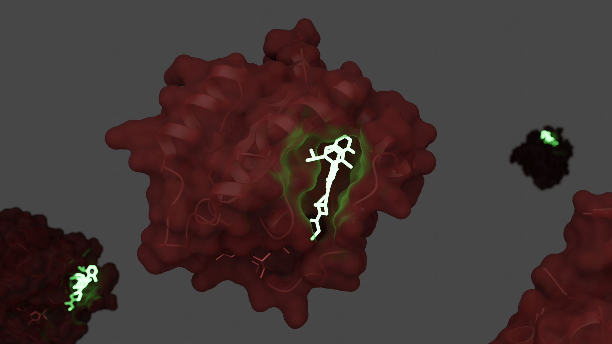

Hey everyone! I am Kieran, currently a [PhD student with Michael Bronstein at Oxford University](https://www.cs.ox.ac.uk/people/kieran.didi/) and a Senior Machine Learning Scientist at the [Fundamental Generative AI team](https://research.nvidia.com/labs/genair/) at NVIDIA. My research focuses on generative models for protein design. You can find my [publications](/publications/) and [CV](/resume/) here.

Besides my research and studies, I love writing, reading, every sport that involves a ball and doing Blender visualisations such as the picture you see below showing K-Ras with an inhibitor or this video showing a [penicillin-binding protein](https://pdb101.rcsb.org/motm/29).

  <iframe src="https://player.vimeo.com/video/768921351?h=7ab3fb6425" style="width:100%;height:100%;" frameborder="0" webkitallowfullscreen mozallowfullscreen allowfullscreen></iframe>

